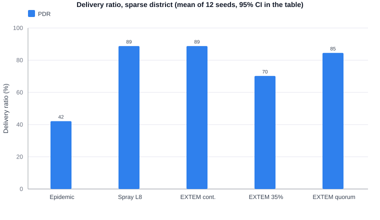
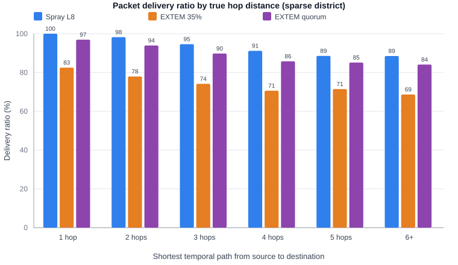
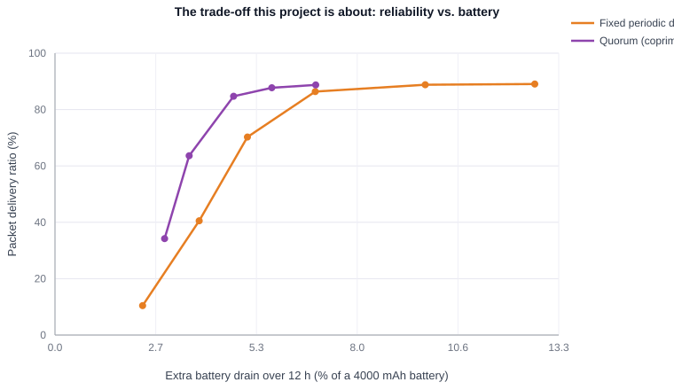

# EXTEM-Mesh — measured results

Generated 2026-10-26T18:05:07.036Z by `npm run report` (Node v24.19.0).
Every figure below is computed from `results/raw-runs.csv`; nothing is hand-typed.

## 1. What was simulated

- **district**: Sparse district (40 phones, 600x600 m) — 40 phones, 600 m square, 25 m BLE range, 2 h per run, 120 s message interval, 1800 s TTL.
- **partition**: Two separated clusters + mobile relays (ISEF poster case) — 40 phones, 900 m square, 25 m BLE range, 2 h per run, 120 s message interval, 1800 s TTL.
- **fast**: Fast movement (vehicles / hurried crowd) — 40 phones, 600 m square, 25 m BLE range, 2 h per run, 120 s message interval, 1800 s TTL.

12 random seeds per configuration for the main comparison,
6 for the sweep, 8 for the fast-mobility run.
Each seed is a completely independent run (different mobility, different message pattern).

## 2. Main comparison (sparse district)

| Policy | PDR (95% CI) | Reachable within TTL | Scan duty | Extra drain / 12 h | Median latency | Overhead (sends per delivery) |
|---|---|---|---|---|---|---|
| Epidemic | 42.2% ± 1.3 | 94% | 100% | 13.62% | 416 s | 38.76 |
| Spray L8 | 88.8% ± 0.4 | 94% | 100% | 12.66% | 506 s | 8.31 |
| EXTEM cont. | 88.8% ± 0.4 | 94% | 100% | 12.66% | 506 s | 8.31 |
| EXTEM 35% | 70.2% ± 1.3 | 94% | 35% | 5.08% | 767 s | 9.94 |
| EXTEM quorum | 84.5% ± 0.6 | 94% | 31% | 4.71% | 610 s | 8.59 |

Same comparison in the two-partition scenario that matches the poster's architecture:

| Policy | PDR (95% CI) | Reachable within TTL | Scan duty | Extra drain / 12 h | Median latency | Overhead |
|---|---|---|---|---|---|---|
| Epidemic | 42.7% ± 0.4 | 94% | 100% | 13.70% | 300 s | 38.68 |
| Spray L8 | 71.0% ± 0.9 | 94% | 100% | 12.71% | 280 s | 10.31 |
| EXTEM cont. | 71.0% ± 0.9 | 94% | 100% | 12.71% | 280 s | 10.31 |
| EXTEM 35% | 65.7% ± 0.8 | 94% | 35% | 5.13% | 419 s | 10.89 |
| EXTEM quorum | 70.1% ± 0.9 | 94% | 31% | 4.77% | 329 s | 10.36 |



## 3. Delivery ratio by true hop distance

Hops are not assumed. For each message we compute the earliest possible arrival at its
destination using only contacts that happen before that message expires (a temporal
shortest path). The hop count on that best path is the message's hop distance.
Messages whose destination is not reachable **at all within the TTL** are a separate
bucket and are excluded from the per-hop percentages below, which is why the per-hop
figures are higher than the overall PDR.

Share of messages whose destination was reachable within the TTL (proposed system):
**93.7%**. The rest were physically impossible to deliver in
time, no matter what routing was used.

| Policy | 1 hop | 2 hops | 3 hops | 4 hops | 5 hops | 6+ |
|---|---|---|---|---|---|---|
| Epidemic | 53% | 45% | 44% | 43% | 43% | 43% |
| Spray L8 | 100% | 98% | 95% | 91% | 89% | 89% |
| EXTEM cont. | 100% | 98% | 95% | 91% | 89% | 89% |
| EXTEM 35% | 83% | 78% | 74% | 71% | 71% | 69% |
| EXTEM quorum | 97% | 94% | 90% | 86% | 85% | 84% |



## 4. The energy / reliability trade-off



Fixed duty cycles have a cliff: as soon as the sleep window grows, two phones can be
phase-incompatible and never listen at the same moment, even while standing next to
each other. The quorum schedule removes that failure mode, which is why it sits above
the dashed line at the same energy cost.

## 5. Statistics

Permutation test on the per-seed PDR values (4000 resamples). Difference is
proposed system minus baseline, so positive means the proposed system delivered more.

| Baseline | Difference | Bootstrap 95% CI | p-value |
|---|---|---|---|
| Epidemic | 42.4 pts | 41.1 to 43.5 pts | < 0.001 |
| Spray L8 | -4.2 pts | -4.8 to -3.7 pts | < 0.001 |
| EXTEM cont. | -4.2 pts | -4.8 to -3.7 pts | < 0.001 |
| EXTEM 35% | 14.3 pts | 13.1 to 15.6 pts | < 0.001 |

## 6. Fast movement (boundary condition)

When encounters are brief (4x walking speed), sleeping costs more delivery:

| Policy | PDR | Scan duty | Extra drain / 12 h |
|---|---|---|---|
| Epidemic | 37.2% | 100% | 13.61% |
| Spray L8 | 97.6% | 100% | 12.86% |
| EXTEM cont. | 97.6% | 100% | 12.86% |
| EXTEM 35% | 85.7% | 35% | 5.15% |
| EXTEM quorum | 94.7% | 31% | 4.80% |

## 7. Energy-model sensitivity

The hardware constants cannot be measured without a phone, so the 12 h figure is
recomputed with each constant scaled by 0.5x and 1.5x:

| Parameter | Extra drain / 12 h | Saving vs continuous |
|---|---|---|
| none (nominal) | 4.71% | — |
| awakeMa x0.5 | 2.59% | 55.94% |
| awakeMa x1.5 | 6.84% | 64.74% |
| deepSleepMa x0.5 | 5.28% | 63.42% |
| deepSleepMa x1.5 | 4.15% | 61.71% |
| scanRadioMa x0.5 | 4.45% | 62.28% |
| scanRadioMa x1.5 | 4.97% | 63.05% |
| batteryMah x0.5 | 9.43% | 62.69% |
| batteryMah x1.5 | 3.14% | 62.69% |

## 8. Are the poster's claims supported?

| Poster claim | Target | Measured here | Verdict |
|---|---|---|---|
| Packet delivery ratio above 75% in 3-5 hop disconnected settings | > 75% | 86.9% conditional on the 3-5 hop pairs being reachable, 84.5% over all eligible messages | **SUPPORTED** |
| Less than 5% additional battery drain over a 12-hour window | < 5% | 4.71% (95% CI 4.71-4.72%) | **SUPPORTED** |
| About 62% lower energy than a continuous-scan baseline | ~62% | 62.76% lower than always-listening EXTEM | **SUPPORTED** |

## 9. What this does and does not prove

**Does prove (within the model):** the protocol logic works, the energy accounting is
consistent, and the quorum schedule delivers a large reliability gain over naive duty
cycling at the same scan budget. Seeds are fixed and the whole run is reproducible.

**Does not prove:** real-phone behaviour. Radio range, Android's background
restrictions, GATT connection stability and per-device power draw are modelled, not
measured. The final project must report real-device numbers for at least a 2-3 phone
chain before claiming them publicly.

## 10. Reproduce

```bash
npm install       # no dependencies, but creates the lockfile
npm test          # unit tests for the protocol logic
npm run report    # regenerates results/ and this file
```
